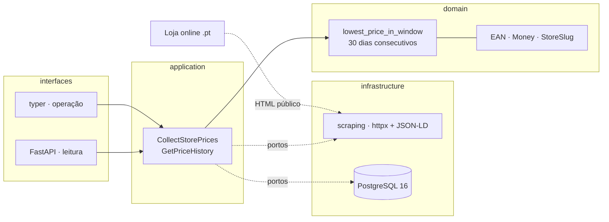

# BraunPrices

**Regista o preço de produtos em lojas online portuguesas, todos os dias, e publica esse
histórico.** Desde 28 de maio de 2022, o [Decreto-Lei n.º 109-G/2021](https://diariodarepublica.pt/dr/detalhe/decreto-lei/109-g-2021-176907406)
obriga quem anuncia um desconto a indicar o preço mais baixo praticado nos 30 dias
consecutivos anteriores — este projeto torna esse número verificável por qualquer pessoa.

[](https://github.com/diegobraun/braunprices/actions/workflows/ci.yml)
[](https://www.python.org/)
[](LICENSE)



> As setas apontam sempre para dentro. O domínio não importa SQLAlchemy, httpx nem
> pydantic — e isso é [verificado por `import-linter`](pyproject.toml) em cada build, não
> confiado à disciplina de quem escreve. Ver [ADR-0001](docs/adr/0001-arquitetura-limpa-com-dominio-isolado.md).

## O que este projeto afirma, e o que não afirma

Cada preço guardado é um **facto observado**, com data, hora e o URL de onde foi lido.
Uma observação nunca é alterada nem apagada: se o preço muda, escreve-se outra
observação. O histórico é *append-only* por definição.

A linguagem é descritiva em todo o lado — no código, na API e aqui. "Este produto esteve
a 59,00 € em 12/07/2026" é o tipo de afirmação que o sistema faz. Julgar a conduta de uma
loja não é função deste software.

## Quickstart

Precisas de [`uv`](https://docs.astral.sh/uv/getting-started/installation/) e, para os
testes de integração, de Docker a correr.

```bash
git clone https://github.com/diegobraun/braunprices.git
cd braunprices
make setup
make lint && make test
```

Se isto não ficar verde num clone limpo, é bug do projeto —
[abre uma issue](https://github.com/diegobraun/braunprices/issues/new/choose).

```bash
make help              # todos os alvos
make run ARGS=version  # a CLI de operação
```

## A regra dos 30 dias

É a regra central do domínio, não um detalhe de relatório. Vive em
`src/braunprices/domain/rules/`, é código puro sem qualquer I/O, e são **duas** funções
porque a lei faz duas perguntas diferentes:

```python
lowest_price_in_window(observations, reference_date, window_days=30) -> Money | None
```
Qual foi o preço mais baixo praticado na janela. Um mínimo, e só isso.

```python
reference_price_for_announcement(...) -> ReferencePrice | None
```
Que número a loja tem de indicar ao anunciar a redução. Normalmente é o mínimo acima —
mas quando a redução foi progressivamente aumentada, o n.º 5 do artigo manda usar o
preço anterior à primeira redução, e não o mais baixo já atingido. O resultado traz
consigo a base que o produziu, para que a resposta possa ser justificada e não apenas
dada.

Os casos onde uma implementação ingénua erra, todos com teste próprio:

- janela sem observações → devolve "sem dados", nunca zero;
- buracos na série → o histórico é discreto, não se interpolam valores que ninguém viu;
- produto sem stock → não conta como preço praticado;
- **descida gradual e ininterrupta** → referência é o preço antes da primeira redução;
- janela que já inclui promoções → conta na mesma; a lei é explícita nisso;
- fronteira de dia em `Europe/Lisbon`, incluindo as noites de mudança de hora.

O raciocínio completo, com o que é redação legal e o que é interpretação deste projeto,
está em [ADR-0008](docs/adr/0008-interpretacao-da-regra-dos-30-dias.md).

## O histórico não se edita, nem por acidente

`price_observations` é append-only, e não por convenção. A base de dados tem um trigger
que recusa `UPDATE` e `DELETE`, com uma mensagem que explica o que fazer em vez disso:

```
ERROR:  price_observations e append-only: UPDATE nao e permitido. Uma observacao errada
        corrige-se registando outro facto, nunca sobrescrevendo o original.
```

As chaves estrangeiras são `ON DELETE RESTRICT`, o que fecha a porta lateral de apagar
uma referência de loja para levar o histórico atrás. O repositório de observações não
expõe `update` nem `delete` — a ausência é a interface.

Os testes de integração correm contra PostgreSQL 16 a sério, em Testcontainers, com as
migrações do Alembic aplicadas. Sem mocks: um duplo concordaria com qualquer coisa que
se lhe pedisse.

## Ética e âmbito da recolha

Esta secção não é decorativa. É o que separa este projeto de um scraper qualquer.

- **`robots.txt` respeitado**, verificado em runtime a cada domínio — não apenas lido
  uma vez durante a implementação.
- **User-agent próprio e identificável**, com URL de contacto do projeto. O sistema nunca
  se disfarça de browser.
- **Rate limit conservador por domínio**, com backoff exponencial. Uma passagem diária
  não pode parecer um ataque a ninguém.
- **Bloqueios param a recolha.** Perante 403, 429 ou captcha, o comportamento correto é
  parar e registar. Contornar bloqueio não é uma opção técnica deste projeto.
- **Zero dados pessoais.** Recolhem-se apenas dados públicos de produto: preço,
  disponibilidade, identificador, nome. Nada é recolhido a partir do browser de
  utilizadores. O RGPD fica fora do caminho crítico porque não há nada a que se aplique.
- **HTML é dado, nunca instrução.** Conteúdo recolhido de páginas é tratado como
  potencialmente hostil e nunca como comando a executar.

És responsável por um site e queres reportar um problema ou pedir exclusão?
Ver [`SECURITY.md`](SECURITY.md) — resolve-se por lá, sem advogados.

Isto não é uma declaração de intenções: cada uma destas regras tem teste. Um URL
proibido nunca chega a ser pedido; um `robots.txt` ilegível interdita o domínio inteiro;
um `Crawl-delay` declarado pela loja prevalece sobre o ritmo configurado; cada código de
bloqueio produz **uma só** tentativa; e o user-agent nunca contém `Mozilla` nem `Chrome`.

A Fnac.pt respondeu 403 ao próprio `robots.txt` durante a escolha da primeira loja. Foi
descartada, não contornada. Ver [ADR-0006](docs/adr/0006-politica-de-recolha.md).

## Estado do projeto

Em construção. O valor deste produto é proporcional ao histórico acumulado, e um dia sem
coletar é um dia perdido para sempre — por isso a prioridade é chegar à recolha diária em
produção (Fase 4) antes de qualquer coisa bonita.

| Fase | O que entrega | Estado |
|---|---|---|
| 0 | Esqueleto, CI, ferramentas | ✅ concluída |
| 1 | Domínio puro e a regra dos 30 dias | ✅ concluída |
| 2 | Persistência (Postgres + Testcontainers) | ✅ concluída |
| 3 | Primeiro scraper (JSON-LD) | ✅ concluída |
| 4 | **Recolha diária em produção** | ⏳ a seguir |
| 5 | API de leitura | ⬜ |
| 6 | Segunda e terceira lojas, casamento por EAN | ⬜ |

O gráfico de histórico de preços aparece aqui, acima da dobra, assim que a Fase 4 tiver
acumulado dados reais para mostrar. Até lá seria uma imagem inventada, e este projeto não
publica números que não observou.

## Stack

Python 3.12+ · [`uv`](https://docs.astral.sh/uv/) · `httpx` · `selectolax` ·
SQLAlchemy 2.0 + Alembic · PostgreSQL 16 · pydantic v2 (só nas bordas) · FastAPI ·
`typer` · pytest + Testcontainers · `ruff` · `mypy --strict` · `import-linter` ·
`pre-commit` · `structlog`

Cada desvio a esta lista exige um ADR. As decisões estão em [`docs/adr/`](docs/adr/).

## Contribuir

Ver [`CONTRIBUTING.md`](CONTRIBUTING.md). Novas lojas passam primeiro por uma issue com o
template *Nova loja* — a verificação de `robots.txt` decide se a loja entra.

## Licença

Código sob [AGPL-3.0-or-later](LICENSE). Os dados recolhidos e a base de dados publicada
ficam sob ODbL-1.0. Observações de preço isoladas são factos e não estão sujeitas a
restrição. O raciocínio completo, incluindo o direito *sui generis* de bases de dados,
está em [ADR-0007](docs/adr/0007-licenciamento-de-codigo-e-de-dados.md).
